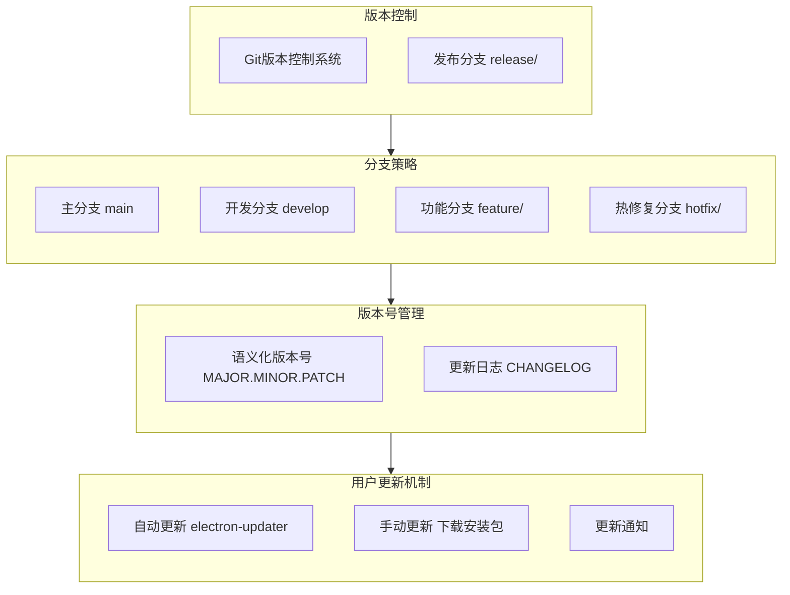

# DSH 使用方法与操作规范

## 什么时候使用/不用 Agent

- 人工负责：目标描述 + 审查产出。
- Agent 负责：项目开发。

> **用 Agent 去做它大概率做砸的事，是最大的时间浪费**
> 比如需要高度创意判断的架构决策、或极细粒度的样式微调

**DSH 在这个项目中“适合做”与“不适合做”的事：**

- 适合交给 DSH 的：项目脚手架、样板代码（数据模型、Repository、Provider）、批量文件重构、运行 `flutter analyze` / `flutter test` / `flutter build` 并修复报错、生成配置文件和构建脚本、编写测试代码。这些任务的共同特征是规则明确、可验证、无需视觉判断。
- 需要你亲自主导的：冲突解决策略的决策、同步可靠性的验收标准、UI/UX 的视觉打磨、各平台真机上的体验验证、以及每一个阶段完成后对 `diff` 的审查。DSH 的自主性很高，但它不“知道”一个 Todo 应用在用户体验上什么算好。比如你之前选 Flutter 是为了降低跨平台维护成本，DSH 的作用是加速你在 Flutter 上的编码循环，而不是替代你对产品质量的判断。

## 核心交互方法

### 消息投递语义：Enter、Tab、Ctrl+Enter 的区别

DSH 在 Agent 正在工作时，对“你再发一条消息”有三种处理路径，理解这个区别能大幅减少来回等待的挫败感：

- **Enter（steer）** ：把你的消息送进**当前正在运行的回合**，Agent 在下一步边界领取。适合“方向微调”，比如“同步逻辑先跳过，只做本地存储”。
- **Tab（follow-up）** ：排入队列，**等当前回合结束后**再处理。适合“这件事之后再做”，不打断 Agent 当下的工作。
- **Ctrl+Enter（interrupt）** ：**立即打断**当前回合，把你的新消息作为当前指令。适合发现 Agent 走错方向、或者你想紧急插入更高优先级的事。

待办软件开发中，最常见的误用是在 Agent 正在写代码时反复用 Enter 插话，导致上下文被稀释。**方向性调整用 Ctrl+Enter 说清楚，补充性事项用 Tab 排队，是最节省上下文的方式。**

### 斜杠命令：高频操作的快捷入口

在输入框中输入 `/` 会弹出当前已注册的命令列表。对于你的项目，最值得在起步阶段就熟悉的命令是：

**`/plan` —— 带需求进入计划模式**
直接输入 `/plan 我要给待办软件增加“重复任务”功能，先只做设计和影响分析`，DSH 会进入计划模式进行只读分析，输出方案供你审阅。这是你控制“大功能”节奏的核心命令。

**`/goal` —— 声明当前阶段的长期目标**
例如 `/goal 完成待办软件 MVP 的本地核心循环：创建、编辑、完成、删除、按截止日期排序`。设置后，Agent 在后续每轮对话中会主动围绕这个目标推进，跑题时也会自行绕回。一个阶段只维护一个 `/goal`，阶段切换时用 `/goal edit` 更新。

**`/compact` —— 会话变长时压缩上下文**
当一个会话已经进行了较长时间，上下文开始冗余时，`/compact` 会把关键信息整理为紧凑摘要，Agent 带着摘要继续工作，而不是被历史对话拖累。待办软件的 UI 细节讨论容易产生大量来回，这个命令在你觉得 Agent “开始健忘”时使用。

**`/export` —— 导出当前对话**
需要把某次讨论留存为决策依据时，`/export` 会下载完整的对话记录压缩包。适合在完成一个重要技术讨论（比如“同步方案选型”）后导出一份，放入项目的决策记录目录。

### `@`文件引用：精准投喂上下文

- 在消息任意位置输入 `@` 会打开文件补全菜单，选中文件后，其内容会自动附加到消息中发送给 Agent。
- 对于每次开工前都要阅读的文档，这个功能的最佳用法不是“每次手动选文件”，而是**在 `AGENTS.md` 中预先写好“开工先读哪几份文档”的规则**，让 Agent 自动按路径读取，减少你手动 `@` 的频率。
- 手动 `@` 保留给“临时需要 Agent 看一份计划外文件”的场景，比如“@docs/contracts.md 看一下 TodoItem 的类型定义，确保新代码不破坏它”。

### 会话交接：长会话的收尾机制

- 当会话变长、Agent 开始“降智”或上下文接近上限时，可以借助社区插件完成交接。
- 如果你不安装插件，也可以用手动方式实现同等效果：在会话结束前，让 Agent 把“当前状态 + 下一步”追加到 `docs/PROGRESS.md`，新会话开始时让它先读这份文件再开工。对个人开发者，**手动交接 + 进度文档**是最低成本的可持续方案，插件可以在会话频繁超长后再引入。

## 安全措施与操作规范

### 会话模式

/plan —— 带需求进入计划模式。此模式Agent只能读取和推理，不能卸乳或修改。但注意明确的要求会让Agent推出该模式。比如当前即便还没有退出plan模式，但对话中说道“接下来开始编码”，Agent有就可以开始修改文件。

### 权限模式

DSH 内置了**沙箱（Sandbox）**，它通过不同的“权限模式”来控制 Agent 能做什么。**千万不要为了“方便”而一直使用最高权限**。

| 权限模式               | 它能做什么（通俗解释）                                         | 安全建议                                                             |
| ---------------------- | -------------------------------------------------------------- | -------------------------------------------------------------------- |
| `read-only`          | 只能“看”，不能“碰”。                                       | 最安全，但没法开发。                                                 |
| `workspace-write`    | **只能在你的“工地”（工作区）内读写**，外面一概不许动。 | **日常开发的默认首选**，兼顾安全和效率。                       |
| `danger-full-access` | **完全放开**，哪里都能读写，包括你的系统文件。           | **仅在绝对必要时临时开启**，用完立刻切回 `workspace-write`。 |

**绝大多数时间都应该保持** `workspace-write` **模式**。这样，即使 AI 想删除文件，也只能删掉你工作区（工地）里的东西，伤不到你电脑上的照片、文档等个人文件。

### 安全插件

### 操作习惯

1. **隔离，为项目单独建一个文件夹**：比如在 D 盘创建一个 `D:\MyProjects\TodoApp` 文件夹，然后在 DSH 里**把这个文件夹选为工作区**。不要直接把整个 D 盘或桌面选为工作区。
2. **备份，用 Git 做“后悔药”**：在开始让 AI 写代码前，为你的项目文件夹初始化一个 Git 仓库（`git init`）。Git 会记录每一次文件变化。万一文件被误删或改坏，你可以轻松地“回滚”到任何一个保存过的版本。这是比任何插件都更可靠的保障。
3. **快照，在让 DSH 执行“危险操作”之前，先手动 Commit + Push**：比如你准备让 DSH 做一次批量重构、删除或移动文件，可以先用 GitHub Desktop 点一次 **Commit**（写清楚“DSH 批量操作前的安全快照”），再点一次 **Push origin**。这样即使 DSH 改坏了本地文件，你既有本地快照可以 Discard/Revert，也有云端快照可以重新下载。
4. **目标，一个阶段只让 DSH 围绕一个 `/goal` 工作。** 需要添加的功能诱惑太多，今天想加标签、明天想加协作、后天想做移动端。`/goal` 的作用就是把这些冲动挡在当前阶段之外。阶段目标没完成，不要 `/goal edit` 去开新战线。
5. **计划，“先计划、后执行”要成为肌肉记忆。** 凡是涉及新增功能、改动数据模型、调整架构的请求，先用 `/plan` 让 Agent 在只读模式下给出方案，你审阅后再切模式执行。**计划模式的成本远低于“让 Agent 写了一堆再回滚”的成本**。
6. **交接，会话长度是有意识的资源。** Agent 在长会话后期会开始遗漏细节、重复已经做过的判断。当你感觉它“忘了前面说过什么”时，不是它变笨了，是上下文到了该压缩或交接的时候。`/compact` 或手动更新 `PROGRESS.md` 后开新会话，比硬撑着继续更高效。（建议使用插件自动压缩和交接）
7. **验收，文档的“完成”以文件为准，不以聊天为准。** Agent 在对话中说“已完成”不等于代码和 `PROGRESS.md` 已经一致。每轮会话结束前，花 30 秒检查 `PROGRESS.md` 是否反映了真实状态。**没有写进文件的进度，下一个会话就不存在。**

## 文档使用方法与管理规范

### 文档格式使用规范

在DeepSeek Harness（DSH）里做开发，Markdown和JSON不是二选一的对立关系，而是**分工协作**的两种“语言”。DSH的文档体系本身就有明确的分层设计，结合你的场景，这份手册可以帮你把它们用在刀刃上。

---

#### 核心原则：DSH的“一种事实，一个归属地”

DSH官方文档标准中有一条关键原则：**每个事实只有一个“家”**，其他文档通过链接指向它，而不是重复描述。

对应到你的开发流程中：
- **Markdown**：是**人类**的“家”，用于讨论、澄清、审批和记录决策。
- **JSON**：是**机器（Agent）** 的“家”，用于承载最终确定、需要被精确执行的结构化规格。

你的角色，就是在这两个“家”之间做翻译和把关。

#### 📝 什么时候用Markdown

**核心场景：任何需要“人”参与阅读理解、讨论和签核的环节。**

| 使用场景 | 具体说明 | DSH生态中的例子 |
| :--- | :--- | :--- |
| **需求澄清与PRD** | 产品需求文档的正文、用户故事、验收标准的自然语言描述 | `dsh-spec-collab`插件就将**Markdown作为需求的主画布**，产研双方在同一份Git版本化的Markdown上完成评论、批注和确认 |
| **方案讨论与决策记录** | 技术选型的讨论过程、被否决的方案及原因、架构决策记录（ADR） | 决策的“为什么”比“是什么”更重要，这部分必须用人话记录下来 |
| **面向人的使用文档** | README、教程、使用指南 | DSH官方将文档明确分类为**教程（Tutorial）**和**参考（Reference）**，教程需要按学习路径有序编排，这是典型的Markdown场景 |
| **Skill的编写** | DSH的Skill文件（`SKILL.md`）本身就是Markdown格式，用于描述该Skill解决什么问题、何时触发 | 官方Skill格式要求frontmatter中包含`name`和`description`，描述应能独立说明Skill的用途 |

**一句话总结**：**凡是需要“说服人、让人点头”的内容，用Markdown。**


#### 🤖 什么时候用JSON

**核心场景：任何需要被Agent“无歧义地执行”或“机器校验”的环节。**

DSH生态中有专门的插件体系来支撑JSON的核心地位。`dsh-docwright`插件的设计哲学就是**“以JSON为唯一事实来源”**，每个pack用JSON Schema定义一种文档类型，Agent按Schema生成产物，生成后自动校验，校验不通过则自动修稿。

| 使用场景 | 为什么用JSON | 具体做法 |
| :--- | :--- | :--- |
| **产品功能结构树** | 层级关系、父子归属需要100%准确，不能被Markdown缩进的模糊性干扰 | 使用**扁平化邻接表**（见下文） |
| **数据模型/数据库Schema** | 表、字段、类型、约束需要机器可读、可验证 | 输出JSON Schema或Pydantic模型定义，让Agent据此生成代码 |
| **Agent的输入/输出契约** | DSH的Structured Output机制允许你强制Agent按特定JSON结构返回结果，避免自由文本的解析灾难 | 在Prompt中嵌入`outputSchema`，或使用`response_format={"type": "json_object"}` |
| **需要被自动校验的规格文档** | 生成后可以用确定性规则重跑校验，不通过则自动回修 | 使用`dsh-docwright`的pack机制，让Agent在Schema约束下生成，失败时自动修稿 |
| **多阶段流水线的中间产物** | 上游产物需要被下游Agent精确消费，不能有歧义 | `dsh-docwright`支持**链式场景**（如plan/req/func/tech），上游JSON产物作为下游的输入锚点 |

**一句话总结**：**凡是需要“被Agent精确执行、被机器严格校验”的内容，用JSON。**


#### 编写注意事项

##### 当使用Markdown时

> 详细使用规范见《Markdown使用说明.md》

1. **保持缩进一致**：如果Markdown里表达了层级，全程用2个或4个空格，绝不混用Tab和空格。Agent对缩进变化非常敏感。
2. **备注/注释要明确归属**：用引用块（`>`）或固定缩进将备注绑定到对应任务下，避免Agent把备注误判为下一个层级的内容。
3. **避免过深层级**：Markdown超过5层嵌套后，可读性和Agent解析准确率都会下降。超过5层，就应该考虑用JSON来表达结构部分。
4. **区分“教程”与“参考”**：DSH文档标准要求，教程按学习路径有序编排、逐步引入概念；参考按主题查阅、不设教学顺序。不要把两者混写在同一文档中。

##### 当使用JSON时（尤其针对深层结构）

- **核心策略：放弃嵌套，使用扁平化“邻接表”。**：深层嵌套JSON会导致括号匹配错误、注意力丢失和生成截断。DSH的Agent生态同样面临这个问题——嵌套结构逃逸和类型不匹配是JSON解析失败的常见根因。

- **邻接表的正确写法：**

```json
[
  { "id": "1", "parentId": null, "name": "任务清单管理区", "notes": "在桌面端是操作区..." },
  { "id": "1.1", "parentId": "1", "name": "UI结构", "notes": "" },
  { "id": "1.1.1", "parentId": "1.1", "name": "用户信息", "notes": "包含头像、昵称" },
  { "id": "1.1.2", "parentId": "1.1", "name": "清单列表", "notes": "" }
]
```

- **为什么邻接表对DSH Agent最友好：**
  - **零嵌套深度**：无论你的产品结构有10层还是100层，JSON本身永远是扁平数组，Agent永远不会数错括号。
  - **天然映射数据库**：邻接表就是关系型数据库存树的标准方式（只需一个`parent_id`字段），Agent可以**零转换**地用它建表、写递归查询。
  - **前端渲染友好**：Agent可以用一个简单的递归函数将扁平数组还原成UI树组件，逻辑清晰且不易出错。
  - **校验简单**：可以用代码轻松校验每个节点的`parentId`是否存在于数组中，杜绝“孤儿节点”。

- **其他JSON编写要点：**
  - **先给Schema，再给数据**：在把JSON数据丢给Agent之前，先给它一个JSON Schema或TypeScript interface定义。有“说明书”的Agent，准确率会显著提升。
  - **避免`key`冲突**：如果做扁平化转换，注意`{"a": {"b": 1}}`和`{"a.b": 2}`扁平后会产生相同的点分路径，需要加前缀或做冲突检测。
  - **明确空值语义**：`""`（空字符串）和`null`（不存在）在Agent眼里含义不同。统一约定：无备注用`""`，无父级用`null`，不要让Agent猜。


#### 推荐工作流：Markdown ↔ JSON 的分工闭环

结合DSH的生态工具，一个稳健的产品设计→Agent开发流程可以是：

```text
[阶段1：人为主导] 
   产品经理用 Markdown 写PRD、用户故事、验收标准
   （可用 dsh-spec-collab 进行逐项批注和确认）
         ↓
[阶段2：人机协作，结构化的“翻译”]
   将Markdown中确认的功能结构，转换为 扁平化邻接表 JSON
   （可让Agent辅助转换，但人必须复核 parentId 链是否正确）
         ↓
[阶段3：Agent主导]
   将 JSON（+ JSON Schema）交给开发Agent
   使用 dsh-docwright 等插件，在Schema约束下生成规格/代码，自动校验
         ↓
[阶段4：回归Markdown]
   生成的文档/代码摘要，再以 Markdown 形式返回给人审阅
```

**关键分界线**：**当讨论结束、决策落定、需要把“共识”固化为“规格”的那一刻**，就是格式切换的节点。Markdown负责达成共识，JSON负责执行共识。DSH的`dsh-docwright`插件甚至直接支持**以JSON为唯一事实来源，再投影生成Markdown**，这正是“JSON做骨架、Markdown做皮肉”理念的官方实践。

### 整体目录结构建议（还需优化）

以下结构直接对应你“用 DSH 开发待办软件”的场景，从项目根开始：

```markdown
todo-app/                              ← 项目根 = Git 仓库根 = DSH 工作目录
│
├── AGENTS.md                          ← 【核心入口】Agent 每次会话自动加载的项目级规则
├── AGENTS.local.md                    ← 仅本机生效的覆盖（加入 .gitignore，不入库）
│
├── docs/                              ← 所有“给人和 Agent 读的文档”
│   ├── PROJECT_STATE.md               ← 当前阶段、MVP 边界、下一个里程碑（人类低频维护）
│   ├── PROGRESS.md                    ← 当前迭代的细分进度（Agent 每轮读写）
│   ├── TODO.md                        ← 任务清单：已完成 / 待办 / 搁置
│   ├── architecture.md                ← 当前系统骨架（现在时，不夹带历史）
│   ├── contracts.md                   ← TodoItem 等核心类型的字面形状与语义（唯一事实源）
│   ├── decisions.md                   ← 轻量决策记录：为什么这样做、放弃了什么
│   ├── DEBT.md                        ← 已知脆弱点和临时方案（按需）
│   └── conventions.md                 ← 命名、提交格式、代码风格硬规则
│
├── 01_Project/                        ← 源代码的“家”
│   ├──src/                            ← 源代码（按你选的技术栈组织）
│   ├──tests/
│   └──package.json 等构建配置
│
├── 02_Design/                         ← 设计源文件与导出素材
├── 03_Research/                       ← 验证证据（竞品截图、用户反馈摘录）
├── 04_Operations/                     ← 上架文案、截图、定价笔记
├── 05_Legal/                          ← 隐私政策、条款
├── 06_Releases/                       ← 构建产物（.gitignore 排除）
└── .gitignore
```

如果你使用的框架（Next.js、Vite 等）要求 `package.json` 和源码在仓库根目录，**保持代码在根上，编号目录与 `docs/` 并列**，不要让构建工具配置去适应“代码必须放进某个编号文件夹”的美学。DSH 的工作目录边界是项目根，代码在根上完全不影响 Agent 的文件读写。

### `AGENTS.md`

> 只写规则，不堆教程

#### 基础使用方法

DSH 按**全局 → 项目根 → 子目录**的顺序加载 `AGENTS.md`，越具体的规则优先级越高。你的项目根 `AGENTS.md` 应当保持短小，只写**每次会话都必须遵守的硬规则**。一个针对待办软件起步阶段的示例：

```markdown
# 项目指令

## 硬规则
- 不要修改 docs/contracts.md 中 TodoItem 的字段语义，除非先提出并获确认。
- 任何功能改动完成后，必须更新 docs/PROGRESS.md 和 docs/TODO.md。
- 不要引入新的状态管理库或持久化库，当前技术栈已锁定。

## 开工顺序
每个新会话开始时，依次读：
1. docs/PROGRESS.md
2. docs/TODO.md
3. docs/architecture.md（如果本次涉及跨模块改动）

## 命令约定
- 包管理器：pnpm
- 测试命令：pnpm test
- 提交信息格式：type: 简短说明（type 用 feat/fix/refactor/docs/chore）

## 风格
- 组件文件名用 PascalCase，工具函数用 camelCase。
- 不要在 UI 组件中直接写存储逻辑，必须经过状态层。
```

**关键纪律**：`AGENTS.md` 是**约束**，不是教程。10 行能说清的规则不要写成 100 行。“不要修改 `contracts.md` 的类型语义”比“请务必注意保持类型一致性”有效得多，**禁止类规则 Agent 执行得更稳**。详细的架构说明、设计理由、操作步骤，全部放在 `docs/` 对应文件里，`AGENTS.md` 只负责“叫 Agent 去读”和“守住底线”。

如果未来某个子目录（比如 `src/platform/`）有独立的平台适配规则，可以在该目录下放一份子级 `AGENTS.md`，只写该子树特有的约束，**不重复根文件已经写过的内容**。DSH 的治理逻辑是“就近治理”，规则放在离它生效位置最近的地方。

#### 扩展方法1:条件调用（不断补充）

> AGENTS.md中一定不能写入大量文字，所以可以使用跳转的形式在需要的时候定位到相关内容.
> 但是需要注意，它的可靠性不如插件强制注入稳定，但完全符合你“只在创建文件时才读”的要求，且不增加任何会话启动时的上下文开销。

**文档结构：**

- 将具体的文档结构写入`file-placement.md`，放入docs目录。
- AGENTS中写入：

  ```markdown
  ## 文件放置规则
  当需要创建任何文件夹或文档时，必须先使用读取 `docs/file-placement.md`，然后严格按其中的路径与命名约定执行。禁止凭记忆或推测决定文件位置。
  ```

#### 扩展方法2:分级管理。规则就近放置，利用目录级 AGENTS.md

如果 file-placement.md 的规则主要约束的是某个特定目录（比如 src/features/ 下的文件结构），更优雅的做法是把规则直接放到那个子目录的 AGENTS.md 里，或者放一份精简版在那里。DSH 原生只会自动加载从项目根到当前工作目录链上的 AGENTS.md。当 Agent 的工作范围触及该子目录时，规则才会被自然带入上下文——这本身就是一种基于工作范围的“按需加载”，不需要任何插件。

#### 扩展方法3:插件

> 注意这种方法会强制阅读所有连带文件，增加token消耗

利用插件强行注入。它会扫描 AGENTS.md 中的 @路径 引用，把被引用文件的内容真正注入会话上下文，让模型能够看到。
例如`dsh-context-imports`插件.
在AGNETS.md中写入：

```markdown
## 文件与目录规范
@docs/file-placement.md
```

这个插件就会强制要求agent阅读AGENTS.md时连带阅读docs/file-placement.md。

### `docs/` 中每份文件的分工与维护节奏

| 文件                           | 回答什么问题                       | 谁维护、多久一次                    | 关键纪律                                                   |
| ------------------------------ | ---------------------------------- | ----------------------------------- | ---------------------------------------------------------- |
| **`PROGRESS.md`**      | 当前任务做到哪了、下一步是什么     | Agent 每完成一个子任务就更新        | 只记“正在做的任务”的细分进度，不堆积历史                 |
| **`TODO.md`**          | 整体上什么做完了、什么还没做       | 人类和 Agent 共同勾选               | 和 `PROGRESS.md` 不重复记同一件事的状态                  |
| **`architecture.md`**  | 现在的系统由哪些模块组成、如何协作 | 阶段1建立，阶段2随模块增加更新      | **只用现在时**，不写“以前/不再”                    |
| **`contracts.md`**     | 核心数据长什么样、字段什么语义     | 阶段1建立，变更需显式确认           | 唯一事实源；Agent 默认不得擅自改语义                       |
| **`decisions.md`**     | 为什么选这个方案、放弃了什么       | 每完成一次重要技术/产品讨论追加一条 | 理由和现状分开放，**理由不塞进 `architecture.md`** |
| **`PROJECT_STATE.md`** | 项目处在哪个阶段、MVP 边界是什么   | 人类在阶段切换时更新                | 低频但重要，Agent 用它判断“现在该做什么级别的事”         |

**一个必须坚守的原则**：同一个事实只在一个文件里展开，其他地方只链接、不复制。`TodoItem` 的字段形状只在 `contracts.md` 里写一次，`architecture.md` 提一句“类型定义见 `contracts.md`”即可。如果 Agent 在 `architecture.md` 和 `contracts.md` 中看到两份不一致的类型描述，它会陷入和你一样的困惑。

### 文档案例

下面以“开发一款类似微软 Todo 的软件”为背景，给出一套 `docs/` 的**文档快照**。每份文档都站在同一个时间点上——**MVP 核心循环已经跑通，正在扩展“截止日期与排序”功能**。你看到的不是“应该写成什么样的规则说明”，而是这些文件**实际长什么样**。

---

#### `docs/PROJECT_STATE.md`：一页纸看清“我在哪”

```markdown
# 项目状态

**最后更新**：2026-11-10
**当前阶段**：阶段 2（功能扩展）
**健康度**：🟢 绿

## 当前焦点
截止日期与排序功能——用户可以为待办项设置截止日期，
列表支持按“截止日期 / 创建时间 / 手动”三种方式排序。

## 下一里程碑
MVP 功能边界内剩余 2 项：搜索、深色模式。完成后进入阶段 3（打磨与发布准备）。

## 明确不做（本阶段）
- 云同步 / 多端实时同步
- 协作与共享清单
- 子任务与重复规则

## 已知风险
- 日期选择器在 Windows 和 macOS 上的交互差异尚未验证（见 DEBT.md #1）
```

这份文档只回答“现在在哪、接下来去哪、不做什么”。**阶段切换时才更新**，平时不动。`AGENTS.md` 里会让 Agent 每次开工先读它，避免把阶段 2 的工作做成阶段 3 的事。

#### `docs/PROGRESS.md`：Agent 每轮读写的“当前进度”

```markdown
# 开发进度

## 2026-11-10 — 截止日期功能收尾

### 已完成
- [x] TodoItem 增加 `dueDate` 字段（`string | null`，ISO 8601 日期）
- [x] 存储层迁移：旧数据 `dueDate` 默认为 `null`
- [x] 列表项右侧显示截止日期标签，过期项红色高亮
- [x] 按截止日期排序（升序 / 降序）

### 进行中
- [ ] 日期选择器组件：桌面端用原生 `<input type="date">`，
      移动端待验证是否可用

### 阻塞
- 无

### 下一步
实现排序方式持久化：用户选择“按截止日期排序”后，重启应用仍保持该选择。

---
## 2026-11-09 — 截止日期数据模型与显示

### 已完成
- [x] 确定 `dueDate` 字段语义：日期粒度为“天”，不含时间与时区
- [x] 更新 `docs/contracts.md` 中 TodoItem 的类型定义
- [x] 存储层兼容旧数据

### 决策
- 截止日期只精确到天，不引入时间部分，避免时区转换的复杂度。
  理由已记入 `docs/decisions.md` #3。
```

格式上有一个关键纪律：**append-only，只追加新条目，不改旧条目**。旧的会话记录不是负担，是 Agent 交接时可以回查的证据。 `PROGRESS.md` 和 `TODO.md` 的分工是：`PROGRESS.md` 管“**当前这个任务做到了哪**”，`TODO.md` 管“**整个项目还有什么没做**”。

#### `docs/TODO.md`：任务清单，带状态和完成日期

```markdown
# 任务清单

## 阶段 2 — 功能扩展

### Ready
- [ ] search：按标题关键字搜索待办项（复杂度：M）
- [ ] dark-mode：跟随系统深色模式（复杂度：S）

### In Progress
- [ ] due-date-picker：日期选择器跨平台验证 — 开始于 2026-11-10

### Blocked
- [ ] sync-architecture：多端同步方案设计 — 阻塞原因：MVP 阶段明确不做，
      待阶段 3 结束后重新评估

### Completed
- [x] due-date-model：TodoItem 增加 dueDate — 完成于 2026-11-09
- [x] due-date-display：列表显示截止日期 — 完成于 2026-11-10
- [x] due-date-sort：按截止日期排序 — 完成于 2026-11-10
- [x] sort-persistence：排序方式持久化 — 完成于 2026-11-10
```

每条待办带**唯一标识、简短描述、复杂度估计、状态、日期**。Agent 完成一项后把它从 `In Progress` 移到 `Completed`，并写完成日期。未完成的条目不要预填日期，**只记事实，不记计划**。

#### `docs/architecture.md`：系统的“现在时”地图

```markdown
# 架构

> 本文只描述**当前**系统结构。决策理由见 `docs/decisions.md`，类型定义见 `docs/contracts.md`。

## 模块图

```

┌──────────────────────────────────────────┐
│              UI Layer                    │
│  TodoList  TodoItem  DatePicker  Toolbar │
└──────────────────┬───────────────────────┘
│ 调用 action，不直接读写存储
┌──────────────────▼───────────────────────┐
│           State Layer                    │
│  TodoStore（当前内存状态 + 操作）         │
└──────────────────┬───────────────────────┘
│ 读写接口
┌──────────────────▼───────────────────────┐
│         Persistence Layer                │
│  LocalStore（文件或 IndexedDB）           │
└──────────────────────────────────────────┘

```markdown

## 关键约束

- UI 层不得直接调用持久化层。所有写入必须经过 State 层。
- `TodoItem` 的字段形状以 `docs/contracts.md` 为唯一事实源，架构文档不重复定义。
- 跨平台差异集中在 UI 层的 `DatePicker` 适配中，状态层和存储层与平台无关。

## 当前技术栈

- 框架：Tauri（桌面端）
- 状态管理：Zustand
- 存储：本地 JSON 文件（通过 Tauri FS API）
- 测试：Vitest
```

架构文档的写法要点：**只用现在时**，不写“以前用 Redux，后来换成 Zustand”。如果有 Mermaid 图，用代码块嵌入，Agent 和人都能读。“约束”一节只写**当前生效的硬边界**，不写“建议”或“可以考虑”。

#### `docs/contracts.md`：核心类型的唯一事实源

```markdown
# 数据契约

> 本文件中的类型定义是**唯一事实源**。其他文档引用类型时只链接，不复制。
> 修改本文件中的字段语义，需先在会话中提出并获得确认。

## TodoItem

| 字段 | 类型 | 必填 | 语义 |
|---|---|---|---|
| `id` | `string` | 是 | 稳定唯一标识，创建后不变 |
| `title` | `string` | 是 | 用户输入的标题，非空 |
| `completed` | `boolean` | 是 | 是否已完成 |
| `createdAt` | `string` | 是 | ISO 8601，创建时刻 |
| `dueDate` | `string \| null` | 否 | ISO 8601 日期（`YYYY-MM-DD`），**只到天，不含时间与时区**；`null` 表示无截止日期 |
| `sortOrder` | `number` | 是 | 手动排序时的相对位置；默认按 `createdAt` 排序时不使用 |

## 契约规则

- `dueDate` 的字符串格式必须是 `YYYY-MM-DD`。禁止写入带时间部分的 ISO 字符串。
- `id` 一旦生成，任何操作不得修改其值。
- 删除操作是软删除还是硬删除，尚未决定；当前 MVP 采用硬删除，变更需记录 ADR。
```

契约文档的核心不是“描述类型”，而是**定义 Agent 不能擅自破坏的硬边界**。表格形式比代码块更适合 Agent 快速扫描字段。如果有多种核心类型（比如未来的 `List`、`Tag`），每种一张表，不混写。

#### `docs/decisions.md`：轻量决策记录（ADR-lite）

```markdown
# 决策记录

> 记录“为什么这样做”和“为什么不那样做”。当前架构状态见 `docs/architecture.md`。

---

## #3 — 截止日期只到天，不引入时间与时区

**日期**：2026-11-09
**状态**：已接受

### 背景
待办类产品的截止日期在用户直觉中是“今天要做完”，而不是“今天 14:00 前”。
引入时间部分会立刻带来时区转换、跨天边界、显示格式等复杂度。

### 决策
`TodoItem.dueDate` 只存储 `YYYY-MM-DD` 格式的日期字符串，不含时间部分。
过期判定以本地时区的自然日为准。

### 备选方案
- **存完整时间戳**：优点是可以做精确提醒；缺点是 MVP 阶段没有提醒功能，
  引入时间部分只会增加不必要的复杂度。拒绝。
- **存时间戳但 UI 只显示日期**：数据层和 UI 层语义不一致，长期容易出错。拒绝。

### 影响
- 存储和排序逻辑更简单。
- 如果未来需要精确到分钟的提醒，需要一次数据迁移。届时重新记录 ADR。

---

## #2 — 状态管理选 Zustand，不选 Redux

**日期**：2026-11-08
**状态**：已接受

### 决策
使用 Zustand 作为状态管理库。

### 理由
个人项目，UI 状态树不复杂。Zustand 无 Provider 包裹、样板代码少，
Agent 生成代码时出错的表面更小。Redux 的 DevTools 和中间件生态在此规模下是过度设计。

### 备选方案
- **Redux Toolkit**：生态成熟，但对单人 Todo 应用而言配置成本高于收益。拒绝。
- **React Context + useReducer**：够用，但跨组件读写时容易产生不必要的重渲染。拒绝。
```

每条决策控制在 1—2 页内，**只记已经做出的决定，不记讨论过程**。状态用“已接受 / 已弃用 / 被 #N 取代”，弃用的条目保留，不删除——Agent 将来问“为什么不用 X”时，答案在这里。

#### `docs/DEBT.md`：已知脆弱点，按需建立

```markdown
# 技术债务与已知脆弱点

## #1 — 日期选择器跨平台行为未验证
**位置**：`src/ui/DatePicker`
**风险**：macOS 原生 date input 的样式和交互与 Windows 可能存在差异；
移动端（如果未来打包）的行为完全未知。
**当前策略**：MVP 桌面端先使用原生 input，阶段 3 统一验证。
**不要做什么**：不要在这个组件上叠加自定义日期面板，等跨平台验证完成后再决定。

## #2 — 本地 JSON 文件存储在数据量增长后可能变慢
**位置**：`src/persistence/LocalStore`
**风险**：当前每次写入重写整个 JSON 文件。待办项超过数百条时，
写放大可能变得明显。
**当前策略**：MVP 阶段不做优化。如果真实用户数据量触发问题，再评估 IndexedDB 或 SQLite。
```

`DEBT.md` 的用途不是“记录所有不完美”，而是告诉 Agent **哪些地方现在不要动、动了要小心**。每一条带“不要做什么”比带“应该做什么”更有约束力。

#### `docs/conventions.md`：Agent 写代码时的硬规则

```markdown
# 开发约定

## 命名
- React 组件文件：`PascalCase.tsx`（如 `TodoItem.tsx`）
- 工具函数文件：`camelCase.ts`（如 `formatDate.ts`）
- 类型定义：集中在 `src/types/`，用 `I` 前缀或 `Type` 后缀二选一，项目内保持一致

## 导入顺序
1. 外部依赖
2. 内部绝对路径（`@/`）
3. 相对路径
各组之间空一行。

## 禁止
- 在 UI 组件中直接 `import` 持久化层。必须经过 State 层。
- 硬编码日期格式字符串。使用 `src/utils/date.ts` 中的格式化函数。
- 在 `contracts.md` 定义的类型上擅自增加字段。新增字段需要先更新契约文档。

## 提交信息
`type: 简短说明`，type 用 `feat` / `fix` / `refactor` / `docs` / `chore`。
```

`conventions.md` 和 `AGENTS.md` 的关系是：**`AGENTS.md` 是“叫 Agent 去读什么、守住什么底线”，`conventions.md` 是“写代码时的具体语法规则”**。如果某条规则短到一两行能说清、且每轮都必须遵守，可以放进 `AGENTS.md`；需要展开说明的命名、导入、禁止事项，放这里。

#### 这些文档组合在一起，Agent 看到的是什么

当 Agent 在一个新会话中按 `AGENTS.md` 的指引依次读取：

1. **`PROJECT_STATE.md`** → 知道现在处于阶段 2，焦点是截止日期与排序，云同步不在当前范围。
2. **`PROGRESS.md`** → 知道截止日期数据模型和显示已完成，日期选择器的跨平台验证正在进行。
3. **`TODO.md`** → 知道排序持久化已完成，搜索和深色模式还在 Ready。
4. **`architecture.md`** → 知道 UI 不能直接碰存储，跨平台差异集中在 DatePicker。
5. **`contracts.md`** → 知道 `dueDate` 只能是 `YYYY-MM-DD`，不能擅自加字段。
6. **`decisions.md`** → 知道为什么日期不到时间、为什么用 Zustand，不会提出已经被拒绝的方案。

**它不需要从头推理“这个项目现在是什么状态”**，只需要执行下一件事，并在完成后更新 `PROGRESS.md` 和 `TODO.md`。这正是这套文档体系的全部目的：**把“当前状态”从聊天上下文中剥离出来，变成 Agent 每次开工都能直接读取的稳定输入。**

## 版本管理方法与规范

### 版本管理架构



### 详细实施策略

#### 1. 版本控制系统 (Git)

**必做事项**：
- 使用Git进行版本控制，将代码托管在GitHub、GitLab或Gitee等平台
- 创建合理的`.gitignore`文件，排除不需要版本控制的文件（如`node_modules/`、构建产物等）

#### 2. 分支策略 (Git Flow)

采用功能分支工作流，适合个人和小型项目：

```bash
main        # 稳定版本分支，直接对应发布版本
develop     # 开发集成分支，包含最新完成的功能
feature/*   # 功能开发分支，每个新功能一个分支
release/*   # 版本发布准备分支，用于测试和修复
hotfix/*    # 紧急修复分支，用于生产环境的问题修复
```

**工作流程**：
1. 从`develop`分支创建`feature/新功能`分支进行开发
2. 完成功能后合并回`develop`分支
3. 准备发布时，从`develop`创建`release/版本号`分支
4. 测试通过后，将发布分支合并到`main`和`develop`
5. 给`main`分支打上标签（tag）标记版本

#### 3. 版本号规范 (语义化版本)

采用**语义化版本控制**(Semantic Versioning, SemVer)：`主版本号.次版本号.修订号` (MAJOR.MINOR.PATCH)

- **主版本号**：做了不兼容的API修改
- **次版本号**：做了向下兼容的功能性新增
- **修订号**：做了向下兼容的问题修正

示例：`v1.2.3`

在`package.json`中管理版本号：
```json
{
  "name": "your-log-app",
  "version": "1.0.0",
  // ...
}
```

#### 4. 更新日志 (CHANGELOG)

维护`CHANGELOG.md`文件，记录每个版本的变更内容，格式如下：

```markdown
# 更新日志

## [1.1.0] - 2023-11-20
### 新增
- 导出功能支持自定义日期范围
- 添加任务分类标签功能

### 修复
- 解决了表格滚动条显示异常的问题

## [1.0.1] - 2023-11-15
### 修复
- 修复了数据文件偶尔读取失败的问题
```

#### 5. 自动更新机制

对于Electron应用，可以使用以下方案实现自动更新：

**方案一：electron-updater (推荐)**
```bash
npm install electron-updater
```

在主进程中配置：
```javascript
const { autoUpdater } = require('electron-updater');

// 检查更新
autoUpdater.checkForUpdatesAndNotify();

// 监听更新事件
autoUpdater.on('update-available', () => {
  // 通知渲染进程显示更新提示
});

autoUpdater.on('update-downloaded', () => {
  // 提示用户重启应用完成更新
});
```

**方案二：手动更新检测**
- 在应用启动时请求API检查最新版本
- 发现新版本时提示用户下载安装包
- 提供一键打开下载页面的功能

#### 6. 数据兼容性处理

考虑到日志数据可能随版本更新而变化，需要处理数据兼容性：

```javascript
// 读取数据时检查版本并迁移
function loadData() {
  const rawData = fs.readFileSync('data.json');
  const data = JSON.parse(rawData);
  
  // 检查数据版本
  if (!data.version || data.version < currentAppVersion) {
    // 执行数据迁移
    return migrateData(data);
  }
  
  return data;
}

// 数据迁移函数
function migrateData(oldData) {
  // 根据旧版本号逐步迁移数据格式
  // ...
  return migratedData;
}
```

#### 7. 发布流程

1. 更新`package.json`中的版本号
2. 更新`CHANGELOG.md`文件
3. 提交更改并打上标签：`git tag v1.2.3`
4. 推送标签到远程仓库：`git push origin --tags`
5. 使用electron-builder打包应用
6. 将打包好的安装包上传到发布页面
7. 更新应用内检查更新的版本信息

#### 8. 用户更新体验

- **小版本更新**：提供自动下载和安装，无需用户干预
- **大版本更新**：提示用户新功能，并引导他们下载安装
- **保留用户设置和数据**：确保更新不会影响用户现有的日志数据

通过这套版本管理策略，你可以有序地迭代你的日志工具，同时为用户提供平滑的更新体验。最初可能觉得有些复杂，但随着项目发展，这些规范会大大减少维护成本。

## 备份同步方法

> 以下是**双分支策略的完整操作指导**。整个流程在 GitHub Desktop 图形界面中完成，不需要命令行。

---

### 为什么不能用 `.gitignore` 解决这个问题

`.gitignore` 的生效前提是**文件从未被 Git 跟踪过**。一旦某个文件或文件夹已经被 `git add` 并提交过一次，它就进入了 Git 的索引（index），此后即使你把它写进 `.gitignore`，Git **仍然会持续跟踪它**，忽略规则对它不再生效。

你的需求是“开发过程文档要留在本地做快照”——这意味着文档**必须被 Git 跟踪并提交**，否则本地快照就失去了意义。因此，文档从一开始就会进入索引，`.gitignore` 对它自然无效。即使你用 `git rm --cached` 停止跟踪，文档也将不再出现在后续的本地提交中，违背了“本地快照”的初衷。

**结论：`.gitignore` 适合用来忽略“永远不需要版本控制”的文件（如编译产物、临时文件），而不适合做“本地保留、云端排除”的分层管理。** 要实现分层推送，必须用**分支**来做隔离。

---

### 操作指导：dev 本地快照 + main 云端发布

#### 第一步：在 GitHub Desktop 中创建 `dev` 分支

1. 在 GitHub Desktop 顶部中间栏，点击 **Current Branch** 旁边的下拉箭头。
2. 在 Branches 标签页中，点击 **New Branch** 按钮。
3. 给新分支命名，例如 `dev`（或 `local-snapshot`），确保基准分支选择当前的 `main`，点击 **Create Branch**。
4. 创建后，GitHub Desktop 会自动切换到 `dev` 分支，你会看到顶部中间栏显示 **Current Branch: dev**。

> ⚠️ **关键规则：从现在开始，永远不要对 `dev` 分支点击 “Publish branch” 或 “Push origin”。** `dev` 分支是一个纯本地分支，它的全部提交历史只存在于你电脑的 `.git` 目录中，不会出现在 GitHub 上。这是实现“文档只留本地”的核心保障。

---

#### 第二步：在 `dev` 分支上进行日常开发与提交

1. 确认当前处于 `dev` 分支（顶部栏显示 `dev`）。
2. 正常修改开发过程文档、代码，以及发布文件夹中的内容。
3. 在左侧 **Changes** 面板中勾选需要纳入本次快照的文件，填写 **Summary**（提交信息），点击 **Commit to dev**。

每一次 Commit 都在**本地**创建了一个包含文档 + 发布文件夹的完整快照。这些快照只存在于你的本地仓库中，**永远不会被推送到云端**。

---

#### 第三步：需要发布时，将发布文件夹的最新状态同步到 `main` 分支

当发布文件夹积累了一批需要上云的内容时，切换到 `main` 分支进行同步。有两种方式，根据你的工作习惯选择一种：

##### 方式 A：直接手动复制（最简单，适合发布文件夹内容较少或结构稳定）

1. 切换到 `main` 分支（通过 **Current Branch** 下拉菜单选择 `main`）。
2. 将 `dev` 分支中**发布文件夹**的最新文件，手动复制到 `main` 分支工作目录下的对应位置。
3. 在 GitHub Desktop 中，你会看到这些文件出现在 Changes 列表中。填写提交信息，点击 **Commit to main**。
4. 点击 **Push origin**，将 `main` 的这次提交推送到 GitHub。

云端 `main` 分支中**只有发布文件夹的内容**，开发文档完全不存在。

##### 方式 B：使用 Cherry-pick 精确选取发布相关的提交（更适合发布文件夹的变更对应明确的提交记录）

如果你在 `dev` 分支上习惯将“发布文件夹的更新”单独提交，可以只把这类提交 cherry-pick 到 `main`：

1. 保持在 `main` 分支，但暂时不切换走。
2. 在 GitHub Desktop 中，通过 **Current Branch** 下拉菜单浏览 `dev` 分支的历史（或切换到 `dev` 的 History 视图）。
3. 找到只涉及发布文件夹变更的那个提交，**右键点击**它，选择 **Cherry-pick commit...**。
4. 选择目标分支为 `main`，GitHub Desktop 会将这个提交的变更复制到 `main` 分支的工作区（或直接创建一个新的提交，取决于版本行为）。
5. 确认 Changes 中只有发布文件夹相关文件，填写提交信息，点击 **Commit to main**。
6. 点击 **Push origin** 推送。

> Cherry-pick 的好处是**精确可控**：即使你在 `dev` 的一个提交中同时修改了文档和发布文件夹，你也可以在 cherry-pick 后于 `main` 的 Changes 面板中**取消勾选文档相关的文件**，只提交发布文件夹的部分。

---

#### 第四步：后续循环

之后的日常流程保持简单：

- **每天/每次开发**：在 `dev` 分支上 Commit，做本地快照。不碰 Push。
- **需要发布时**：切换到 `main`，同步发布文件夹的最新内容，Commit，然后 **Push origin**。

`main` 分支在 GitHub 上始终保持干净，只有发布相关内容；`dev` 分支在本地承载了包含全部文档的完整历史快照。

---

### 注意事项与排障

**1. 不要误推 `dev` 分支。** GitHub Desktop 在 `dev` 分支上可能会显示 **“Publish branch”** 按钮（因为该分支尚未存在于远程）。**不要点击它。** 一旦点击，`dev` 分支连同其中的所有文档都会被推送到 GitHub。如果误点了，可以在 GitHub 网页端删除远程的 `dev` 分支，本地分支不受影响。

**2. `main` 分支的初始状态。** 如果你的 `main` 分支是在创建 `dev` 之前就已经包含文档的旧提交，需要先清理一次：在 `main` 分支上删除文档文件夹，Commit，Push。此后 `main` 就不会再出现文档。

**3. 如果发布文件夹和文档文件夹在同一个提交中混杂修改。** 在 `dev` 上 Commit 时，可以在 Changes 面板中**分批勾选**：先只勾选发布相关文件提交一次，再勾选文档提交另一次。这样后续 cherry-pick 到 `main` 时会更精确，不需要事后取消勾选。

**4. 方案一的局限性。** `main` 分支中不包含开发文档，因此云端仓库缺少文档上下文。如果未来有协作者需要在云端查阅文档，或者你需要在另一台设备上恢复完整开发环境，文档只能从你本地这台电脑的 `.git` 中获取。如果对“文档也需要一份异地容灾”有需求，可以考虑将 `dev` 分支推送到**另一个完全私有的远程仓库**（而非发布用的 GitHub 仓库），但这不是本方案的必要部分，按需选用。

## 如何提高工作质量

### Prompt Engineering（提示词工程）

与 AI 交互需要通过提示词告诉 AI「角色、任务、要求、如何交付」等信息。

通过设计和优化提示词，来改善模型表现的过程就是 Prompt Engineering。

#### Agent 配置

维护好自己的 `agents.md`，即工作说明。把长期适用的要求提前写好。包括：

1. 全局级别配置

   > 即通用的做事规则
   >
2. 项目级别配置

   > 放在项目目录里。补充项目的具体要求。比如技术栈、文件怎么组织、怎么测试
   >

#### 怎么写好提示词

从“聊天”转向“写需求文档”。最关键的认知转变是：**提示词不是聊天，而是一份简洁但完整的需求文档**。

对 Coding Agent 而言，它本身就是一个“读文件 → 改代码 → 跑命令”的循环，**不需要你在提示词里教它“请一步步思考”或“请先搜索代码”**——这些能力已经内置，重复要求只会浪费 Token 并干扰判断。

一个高效的编码提示词，骨架是 **“目标 → 上下文 → 约束 → 成功标准”**，复杂任务再加一条 **“非目标”** 来划定禁区：

| 要素               | 要回答的问题             | 反面示例             | 正面示例                                                                                                        |
| ------------------ | ------------------------ | -------------------- | --------------------------------------------------------------------------------------------------------------- |
| **目标**     | 当前是什么，要变成什么？ | “帮我优化一下代码” | `save_file()` 当前会把空内容也写入磁盘，改为空内容时弹出确认框且不写入                                        |
| **上下文**   | 哪里相关？怎么复现？     | “有个 bug”         | `@src/notepad.py` 第 47 行，运行 `python app.py` 后点击保存空文件即可复现，报错原文：`PermissionError...` |
| **约束**     | 什么不能动？             | （不写）             | 只改 `save_file` 函数，不要动 UI 层，不要引入新依赖                                                           |
| **成功标准** | 怎样算做完？             | “改好就行”         | 运行 `pytest tests/test_save.py` 全部通过，手动测试空内容保存不再写入磁盘                                     |

#### 一个特别适合代码 Agent 的技巧

在“上下文”中直接贴报错原文 + 用 `@path` 指向相关文件，比用自然语言描述代码准确得多，因为模型读代码比读你的描述更准。

对于 DeepSeek 模型，官方实践还提示少用 Few-shot 示例，直接把任务边界和验收标准写清楚效果更好。

### Context Engineering（上下文工程）

#### 给模型组织好他这次工作需要的信息

**维护好上下文文档**
尤其是做大项目。包括项目目标、已经确定的方案、当前进度、接下来要做什么（比如 DSH 的 Billion Context 插件可以帮助管理和压缩上下文）。

**多开新对话**
项目很大，不代表所有事情都要在一个对话里完成。建议按功能、按阶段拆解对话。一个工作或阶段完成后，就更新到上下文文档里。再新开一个对话让 AI 读完继续干。好处如下：

- 以保证项目持续推进。
- 每个对话也都有清楚的任务。
- 保持整个项目的连续性。

#### 管理好 Agent“眼前”和“手边”的信息

Agent 变“笨”，往往不是模型不行，而是上下文腐烂，即无关信息挤占了注意力，关键信息被淹没。你需要在两个维度上主动管理：

**会话策略：把“规划”和“执行”拆开**
面对模糊需求时，先开一个规划会话，让 Agent 出方案、你审方案；方案确定后，再开一个干净的执行会话去落地。这能显著降低跑偏率。不要把“画出整只猫头鹰”的期望压在一个超长会话里。

**上下文锚点：用文件固化“真相”。**
在你的项目根目录建一个 `AGENTS.md`（或 `CLAUDE.md`），作为 Agent 的“活地图”。初始只写三样东西：项目是什么、怎么跑起来、怎么验证。之后每当 Agent 犯一个错，就在这个文件里追加一条对应规则。例如：

- Agent 改了不该改的配置文件 → 追加“不要修改 `config/` 下的任何文件”
- Agent 提交前没跑测试 → 追加“修改后必须运行 `pytest`，通过后方可声明完成”

这个文件要保持在“地图”形态（约 100 行以内），规则多了就拆到 `docs/` 子文档，避免它本身变成挤占上下文的负担。

### Harness Engineering（驾驭工程）

包括工具怎么执行、结果怎么传回来、出错后怎么办、任务怎么继续。

让系统在你设定的规则下持续稳定安全可控地推进任务，最终交付结果。

#### 让“这次做对”变成“每次都做对”

这是高质量开发最核心、也最容易被忽视的一层。它的心法只有一句话：Agent 每犯一次错，就工程化一个机制，让它永远不再犯这个错。

你在对话里纠正一次，只是“消费”了一次教训；把它变成一个文件、规则或脚本，才是“投资”。

| 旧反应（消费）                        | 新反应（投资）                                                   |
| ------------------------------------- | ---------------------------------------------------------------- |
| 在对话里说“不对，应该先跑 `lint`” | 把 `lint` 命令写进 `AGENTS.md` 的验证段                      |
| 手动改掉 Agent 生成的违规代码         | 加一条 `lint` 规则或 `pre-commit hook`，让违规在提交时被拦下 |
| 每次人肉检查“有没有忘记写测试”      | 把测试命令写成 Agent**必须执行的自验证回路**               |

#### 最关键的单项投资：给 Agent 装上“自验证回路”

如果你给 Agent 一个验证自己工作的方法，它多半会自己修好错误。对于记事本这类小项目，一个极简的回路就够了：

- **写代码** → 让 Agent 在完成修改后**必须运行 `pytest` 和 `ruff check`**（或你选用的 `lint` 工具），把命令写进 `AGENTS.md` 的“验证”段。
- **写 UI** → 如果有条件，给一个截图脚本或浏览器检查命令，让 Agent 对比预期效果。
- **通用原则**：**把验收标准前置到任务开始时给出**（就在提示词的“成功标准”里），而不是等 Agent 做完后由你人肉验收。
