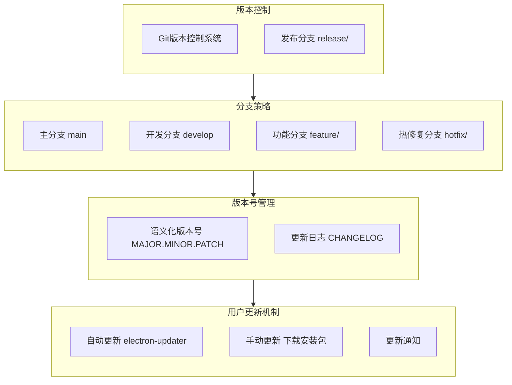

# 版本管理方法与操作规范

## 版本管理架构



## 详细实施策略

### 1. 版本控制系统 (Git)

**必做事项**：
- 使用Git进行版本控制，将代码托管在GitHub、GitLab或Gitee等平台
- 创建合理的`.gitignore`文件，排除不需要版本控制的文件（如`node_modules/`、构建产物等）

### 2. 分支策略 (Git Flow)

采用功能分支工作流，适合个人和小型项目：

```bash
main        # 稳定版本分支，直接对应发布版本
develop     # 开发集成分支，包含最新完成的功能
feature/*   # 功能开发分支，每个新功能一个分支
release/*   # 版本发布准备分支，用于测试和修复
hotfix/*    # 紧急修复分支，用于生产环境的问题修复
```

**工作流程**：
1. 从`develop`分支创建`feature/新功能`分支进行开发
2. 完成功能后合并回`develop`分支
3. 准备发布时，从`develop`创建`release/版本号`分支
4. 测试通过后，将发布分支合并到`main`和`develop`
5. 给`main`分支打上标签（tag）标记版本

### 3. 版本号规范 (语义化版本)

采用**语义化版本控制**(Semantic Versioning, SemVer)：`主版本号.次版本号.修订号` (MAJOR.MINOR.PATCH)

- **主版本号**：做了不兼容的API修改
- **次版本号**：做了向下兼容的功能性新增
- **修订号**：做了向下兼容的问题修正

示例：`v1.2.3`

在`package.json`中管理版本号：
```json
{
  "name": "your-log-app",
  "version": "1.0.0",
  // ...
}
```

### 4. 更新日志 (CHANGELOG)

维护`CHANGELOG.md`文件，记录每个版本的变更内容，格式如下：

```markdown
# 更新日志

## [1.1.0] - 2023-11-20
### 新增
- 导出功能支持自定义日期范围
- 添加任务分类标签功能

### 修复
- 解决了表格滚动条显示异常的问题

## [1.0.1] - 2023-11-15
### 修复
- 修复了数据文件偶尔读取失败的问题
```

### 5. 自动更新机制

对于Electron应用，可以使用以下方案实现自动更新：

**方案一：electron-updater (推荐)**
```bash
npm install electron-updater
```

在主进程中配置：
```javascript
const { autoUpdater } = require('electron-updater');

// 检查更新
autoUpdater.checkForUpdatesAndNotify();

// 监听更新事件
autoUpdater.on('update-available', () => {
  // 通知渲染进程显示更新提示
});

autoUpdater.on('update-downloaded', () => {
  // 提示用户重启应用完成更新
});
```

**方案二：手动更新检测**
- 在应用启动时请求API检查最新版本
- 发现新版本时提示用户下载安装包
- 提供一键打开下载页面的功能

### 6. 数据兼容性处理

考虑到日志数据可能随版本更新而变化，需要处理数据兼容性：

```javascript
// 读取数据时检查版本并迁移
function loadData() {
  const rawData = fs.readFileSync('data.json');
  const data = JSON.parse(rawData);
  
  // 检查数据版本
  if (!data.version || data.version < currentAppVersion) {
    // 执行数据迁移
    return migrateData(data);
  }
  
  return data;
}

// 数据迁移函数
function migrateData(oldData) {
  // 根据旧版本号逐步迁移数据格式
  // ...
  return migratedData;
}
```

### 7. 发布流程

1. 更新`package.json`中的版本号
2. 更新`CHANGELOG.md`文件
3. 提交更改并打上标签：`git tag v1.2.3`
4. 推送标签到远程仓库：`git push origin --tags`
5. 使用electron-builder打包应用
6. 将打包好的安装包上传到发布页面
7. 更新应用内检查更新的版本信息

### 8. 用户更新体验

- **小版本更新**：提供自动下载和安装，无需用户干预
- **大版本更新**：提示用户新功能，并引导他们下载安装
- **保留用户设置和数据**：确保更新不会影响用户现有的日志数据

通过这套版本管理策略，你可以有序地迭代你的日志工具，同时为用户提供平滑的更新体验。最初可能觉得有些复杂，但随着项目发展，这些规范会大大减少维护成本。
